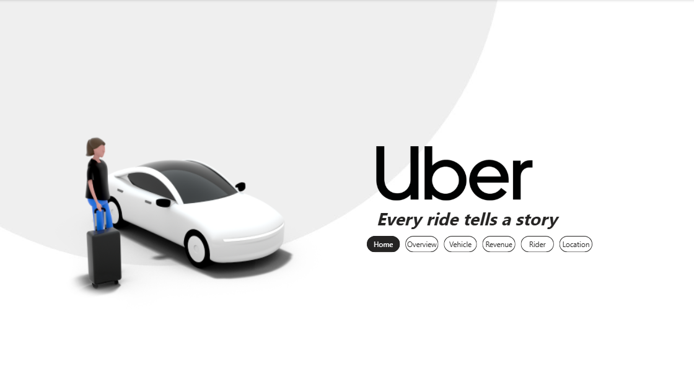
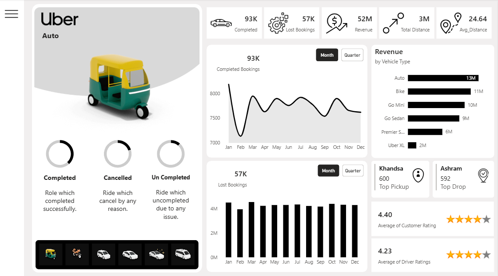
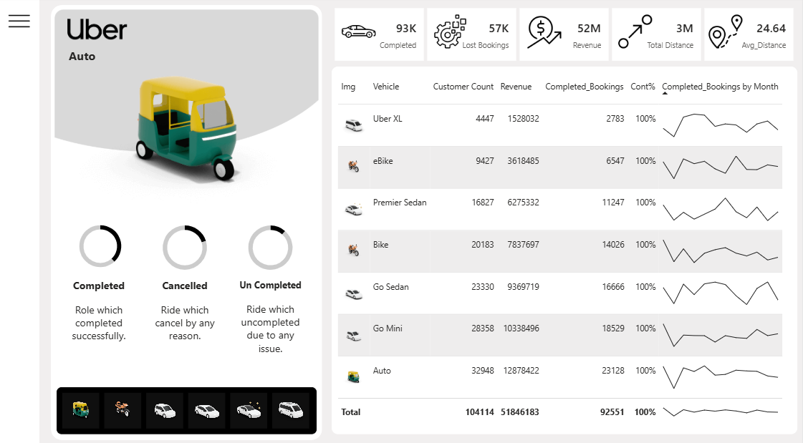
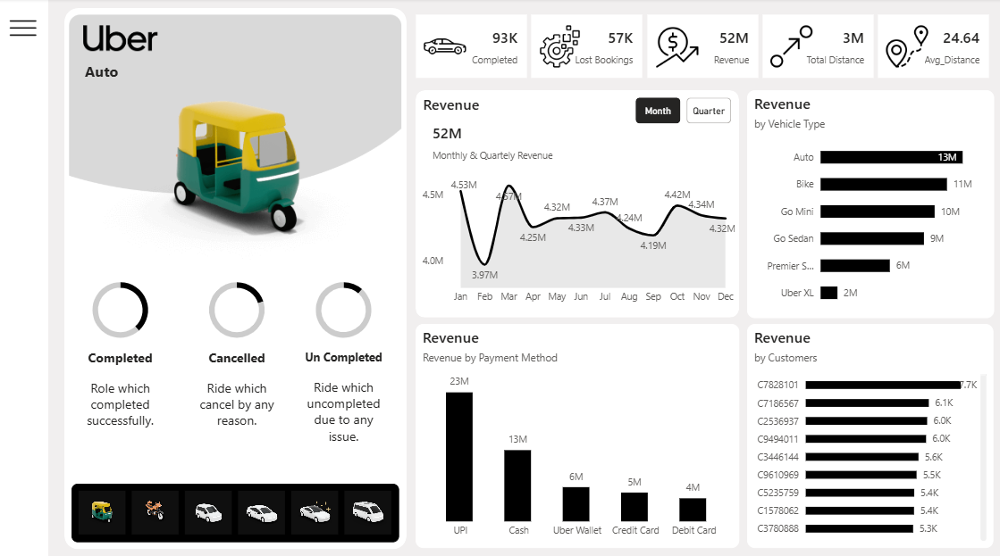
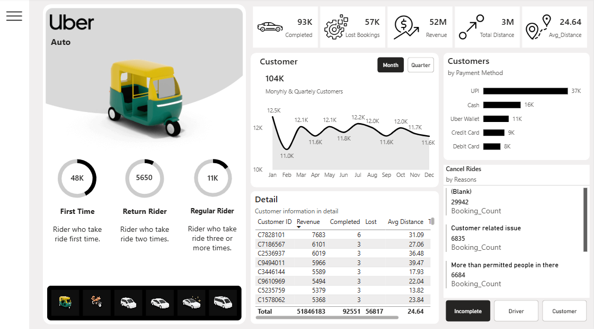
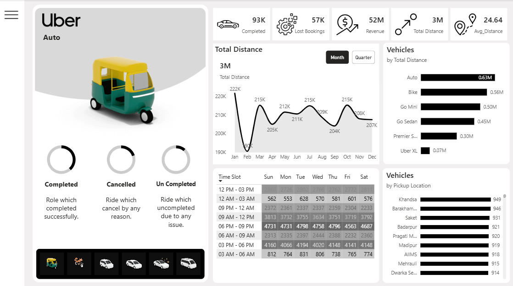
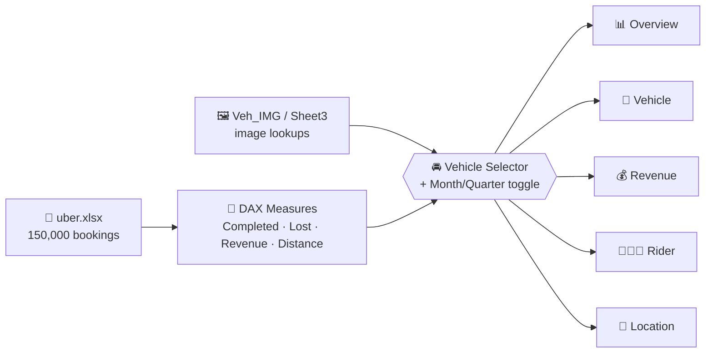

[README.md](https://github.com/user-attachments/files/33293452/README.md)
<div align="center">

# 🚖 Uber Ride Analytics Dashboard

### A Six-Page Power BI Report on 150,000 Bookings — Vehicles, Revenue, Riders, and Locations


</div>

<br/>

> *"Every ride tells a story."* This report turns 150,000 raw bookings into six connected pages that answer where the revenue comes from, who the riders are, and why 38% of bookings never get completed.

---

## 📑 Table of Contents

- [Overview](#-overview)
- [Dashboard Preview](#️-dashboard-preview)
- [Dataset](#️-dataset)
- [How It's Wired Together](#-how-its-wired-together)
- [Report Pages in Detail](#-report-pages-in-detail)
- [Interactive Design](#️-interactive-design)
- [Key Insights](#-key-insights)
- [Business Questions Answered](#-business-questions-answered)
- [Skills Demonstrated](#-skills-demonstrated)
- [Tools & Techniques](#️-tools--techniques)
- [Possible Extensions](#-possible-extensions)
- [Project Structure](#-project-structure)
- [How to Use](#-how-to-use)
- [Contact Me](#-contact-me)

---

## 📌 Overview

**Uber Ride Analytics Dashboard** is a Power BI report built on a year of ride-hailing bookings (calendar year 2025) across Delhi-area pickup and drop locations. It's organized as a guided story across **six pages** — Home, Overview, Vehicle, Revenue, Rider, and Location — all sharing the same layout: a vehicle-selector panel on the left, a five-metric KPI strip across the top, and a page-specific analysis area.

Every page responds to the same vehicle selector and the same Month/Quarter toggle, so a single click on a vehicle (say, Auto) re-slices the entire report around that vehicle type.

---

## 🖼️ Dashboard Preview

<div align="center">

### 🏠 Home
*Brand landing page with a navigation bar to every section.*



<br/><br/>

### 📊 Overview
*Completed vs. lost bookings by month, revenue by vehicle type, top pickup/drop, and average ratings.*



<br/><br/>

### 🚗 Vehicle
*A vehicle-by-vehicle scorecard with customers, revenue, completed bookings, and monthly sparklines.*



<br/><br/>

### 💰 Revenue
*Monthly and quarterly revenue, revenue by vehicle, by payment method, and by top customers.*



<br/><br/>

### 🧑‍🤝‍🧑 Rider
*Rider loyalty segments, payment preferences, a customer detail table, and cancellation reasons.*



<br/><br/>

### 📍 Location
*Distance trends, a time-slot × weekday heatmap, and the busiest pickup locations.*



</div>

<br/>

<div align="center">

| Completed | Lost Bookings | Revenue | Total Distance | Avg. Distance | Customer Rating | Driver Rating |
|:---:|:---:|:---:|:---:|:---:|:---:|:---:|
| **93K** | **57K** | **52M** | **3M** | **24.64** | **4.40 ★** | **4.23 ★** |

</div>

---

## 🗃️ Dataset

`uber.xlsx` contains three sheets: the main bookings table plus two small lookup sheets that supply the vehicle and booking-status images used in the report.

| Sheet | Rows | Description |
|---|---|---|
| `Sheet1` | 150,000 | One row per booking: date, time, booking ID, status, customer, vehicle type, pickup/drop location, cancellation and incomplete-ride reasons, booking value, ride distance, ratings, and payment method |
| `Veh_IMG` | 6 | Vehicle type → image URL (drives the vehicle selector strip) |
| `Sheet3` | 5 | Booking status → icon URL |

**Verified scope of the data:**
- 📅 Bookings span **2025-01-01 to 2025-12-30**
- 🧾 **150,000** bookings from **104,114** unique customers
- ✅ **93,000 Completed** · ❌ **27,000 Cancelled by Driver** · ❌ **10,500 Cancelled by Customer** · 🚫 **10,500 No Driver Found** · ⚠️ **9,000 Incomplete** — so **57,000 bookings (38%) were lost**
- 💰 Total booking value: **51.85M** across an average ride distance of **24.64**
- 🚘 **7 vehicle types** (Auto, Go Mini, Go Sedan, Bike, Premier Sedan, eBike, Uber XL) and **5 payment methods** (UPI, Cash, Uber Wallet, Credit Card, Debit Card)
- 📍 **176** distinct pickup locations and **176** drop locations

---

## 🔗 How It's Wired Together



The same measures feed every page, so a number on the Overview page is always reconcilable with the same number on Vehicle, Revenue, Rider, or Location.

---

## 📊 Report Pages in Detail

### 🏠 Home
A branded landing page with a page-navigator bar linking to all five analytical pages.

### 📊 Overview
Five KPI cards (**Completed**, **Lost Bookings**, **Revenue**, **Total Distance**, **Avg. Distance**), then:
- **Completed Bookings** and **Lost Bookings** trend charts, switchable between Month and Quarter
- **Revenue by Vehicle Type** bar chart
- **Top Pickup** (Khandsa, 600 bookings) and **Top Drop** (Ashram, 592 bookings) callouts
- **Average Customer Rating** (4.40) and **Average Driver Rating** (4.23), shown as star ratings

### 🚗 Vehicle
A vehicle scorecard table: image, **Customer Count**, **Revenue**, **Completed Bookings**, **Contribution %**, and a monthly **Completed Bookings sparkline** for each of the 7 vehicle types, with grand totals (104,114 customers · 51.85M revenue · 92,551 completed bookings).

### 💰 Revenue
- **Monthly & Quarterly Revenue** area chart with data labels (monthly revenue stays in a tight ~4.0M–4.5M band, with a clear dip to 3.97M in February)
- **Revenue by Vehicle Type** (Auto leads at 13M, then Bike 11M, Go Mini 10M, Go Sedan 9M, Premier Sedan 6M, Uber XL 2M)
- **Revenue by Payment Method** — **UPI 23M**, Cash 13M, Uber Wallet 6M, Credit Card 5M, Debit Card 4M
- **Revenue by Customers** — top 10 customers by total spend

### 🧑‍🤝‍🧑 Rider
Three rider-loyalty rings and the analysis around them:
- **First Time** riders (~48K) · **Return** riders (5,650) · **Regular** riders (~11K)
- **Monthly & Quarterly Customers** trend (104K customers in total)
- **Customers by Payment Method**
- A **Customer detail table** (revenue, completed rides, lost rides, avg. distance per customer)
- A **Cancel Rides by Reasons** panel with **Incomplete / Driver / Customer** toggle buttons

### 📍 Location
- **Total Distance** trend by month (3M total)
- **Vehicles by Total Distance** and **Vehicles by Pickup Location**
- A **Time Slot × Weekday heatmap** — the 06 PM–09 PM slot is the clear peak every day of the week (roughly 4,600–4,800 bookings per weekday), followed by 03 PM–06 PM and 09 AM–12 PM

---

## 🎛️ Interactive Design

- **Vehicle selector strip** — the six vehicle thumbnails along the bottom of the left panel act as a slicer; the vehicle illustration and name at the top of the panel update to match
- **Month / Quarter toggle** — a field-parameter switch on every trend chart changes the time grain without leaving the page
- **Rider cancellation toggle** — Incomplete / Driver / Customer buttons on the Rider page swap the cancel-reason breakdown
- **Collapsible menu** — the hamburger icon on the top left opens and closes the navigation panel through Power BI bookmarks (`Overview - Open` / `Overview - Close`)
- **Page navigator** — consistent navigation across all six pages

---

## 💡 Key Insights

- **38% of bookings are lost** (57K of 150K). Driver cancellations are the biggest single cause at 27,000 — more than customer cancellations and "No Driver Found" combined.
- **Revenue is remarkably steady month to month** (~4.0M–4.5M), with February the only visible dip — it's also the shortest month, and completed bookings fall to their lowest (7,130) that month.
- **Auto, Bike, and Go Mini lead on revenue**, but **UPI** is the dominant payment method, carrying more revenue (23M) than Cash (13M) and Uber Wallet (6M) combined.
- **Peak demand is 6 PM–9 PM** on every day of the week, which tells operations exactly when driver supply matters most.
- **Rider loyalty is thin**: roughly 48K riders took a single ride, versus only ~11K regular riders (3+ rides) — a clear retention opportunity.
- **Satisfaction is solid but uneven**: customers rate rides 4.40 on average, while driver ratings sit lower at 4.23.

---

## ❓ Business Questions Answered

- How many bookings get completed, and how many are lost — and why?
- Which vehicle types drive the most revenue, customers, and distance?
- How does revenue move month to month and quarter to quarter?
- Which payment methods do riders prefer, and how much revenue does each carry?
- How many riders are first-timers, returning, or regulars?
- Who are the highest-value customers?
- When (time slot and weekday) and where (pickup locations) is demand highest?
- How satisfied are customers and drivers?

---

## 🧠 Skills Demonstrated

- **DAX measures** — Completed and Lost Bookings, Revenue, Total and Average Distance, Customer Count, contribution %, and rider-segment counts (first-time / return / regular)
- **Field parameters** — Month/Quarter time-grain switching and the Incomplete/Driver/Customer cancel-reason toggle
- **Bookmarks and navigation** — a collapsible menu and a page navigator for an app-like experience
- **Advanced slicers** — image-based vehicle selection that re-slices the whole report
- **Data modeling** — an Excel fact table plus image lookup sheets, with rider segments derived from booking history
- **Visual design** — a consistent black-and-white layout, KPI strip, sparklines, heatmap matrix, and star-rating visuals across six pages

---

## 🛠️ Tools & Techniques

- **Power BI Desktop** — data modeling, DAX, report design, bookmarks, and page navigation
- **DAX** — measures for bookings, revenue, distance, customer counts, and rider segmentation
- **Field Parameters** — dynamic Month/Quarter axis and cancel-reason switching
- **Excel** — source data and image lookup tables
- **Visuals used** — KPI cards, area/line charts, clustered bar and column charts, donut rings, tables with sparklines, a matrix heatmap, and slicers

---

## 🔮 Possible Extensions

- Add a **map visual** of pickup and drop locations to complement the heatmap and location bar charts
- Add a **cancellation-rate trend** and a driver-level view to dig into why 27K bookings are cancelled by drivers
- Introduce **surge/peak-hour pricing analysis** on top of the 6 PM–9 PM demand peak
- Add **rider cohort retention** to track how many first-time riders become repeat riders
- Publish to **Power BI Service** with scheduled refresh

---

## 📁 Project Structure

```
Uber-Analytics-Dashboard/
├── README.md
├── Uber.pbix
├── uber.xlsx
└── assets/
    ├── dashboard-home.png
    ├── dashboard-overview.png
    ├── dashboard-vehicle.png
    ├── dashboard-revenue.png
    ├── dashboard-rider.png
    └── dashboard-location.png
```

---

## 🚀 How to Use

1. Download `Uber.pbix` and `uber.xlsx` from this repository.
2. Open `Uber.pbix` in **Power BI Desktop**.
3. If prompted, repoint the data source to the location of `uber.xlsx` on your machine (**Transform data → Data source settings**).
4. Start on the **Home** page and use the navigator to move between Overview, Vehicle, Revenue, Rider, and Location.
5. Click a vehicle thumbnail in the left panel to re-slice every page, and use the Month/Quarter buttons to change the time grain.

---

## 📬 Contact Me

<div align="center">

[](mailto:salemomar676@gmail.com)
[](https://gamma.app/docs/Copy-of-Brand-Partnership-Proposal-lrp9yrhau9gdpj1)
[](https://www.linkedin.com/in/eng-omarsalem)

</div>
